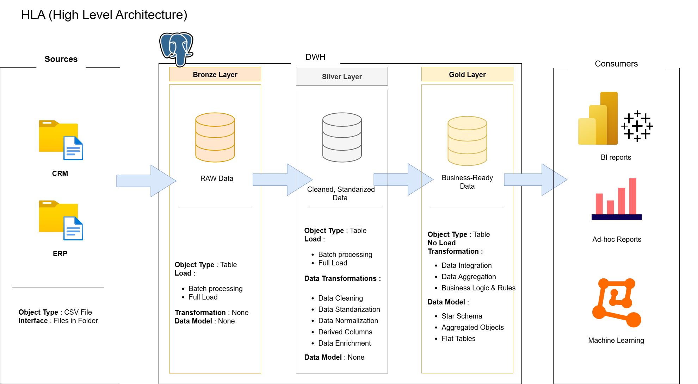

# 🏢 Sales Data Warehouse & Analytics Solution

This repository demonstrates a comprehensive **Data Warehouse and Analytics Solution** built using **PostgreSQL**. The project covers the full data journey — from integrating multiple source systems to generating actionable business insights — and is designed for portfolio demonstration of modern data engineering and analytics best practices.

---

## 🚀 Project Overview

This project aims to **build a dimensional data warehouse** that consolidates sales data and supports complex analytics for informed decision-making.

### Key Objectives

**Data Engineering (DWH)**

- Ingest and unify data from two source systems: **ERP** and **CRM** (CSV files).  
- Implement **data quality checks** to resolve inconsistencies.  
- Transform and integrate data into a **dimensional star schema** for analytics.  
- Document the data model and architecture for business and analytics teams.  

**Analytics & Reporting (BI)**

- Execute SQL-based analytics to uncover insights in:  
  - **Customer Behavior:** top customers, purchase frequency  
  - **Product Performance:** best-selling items, revenue by category  
  - **Sales Trends:** MoM/YoY analysis, regional sales distribution  

---

## 🏗️ Architecture & ETL Layers

Inspired by the [DataWithBaraa SQL DWH project](https://github.com/DataWithBaraa/sql-data-warehouse-project), this project follows a **Medallion Architecture**:

| Layer | Description |
|-------|------------|
| **Bronze** | Raw ingestion of CSV files into PostgreSQL staging tables |
| **Silver** | Cleansing, standardization, and normalization of data |
| **Gold** | Business-ready star schema optimized for analytics |



---

## 🛠️ Tools & Technologies

| Category | Tool | Purpose |
|----------|------|--------|
| Data Warehouse | 🐘 PostgreSQL | Core database for schema and data storage |
| Visualization | 🎨 Draw.io | Architecture and dimensional model diagrams |
| Documentation | 📝 Notion | Project notes, design, and tracking |
| Containerization | 🐳 Docker | *(Future Enhancement: Environment reproducibility)* |

---

## 📂 Repository Structure

```text
datasets/        # Raw ERP & CRM CSV files
scripts/         # SQL scripts for ETL & transformations
 ├── bronze/     # Raw data ingestion
 ├── silver/     # Cleansing & standardization
 └── gold/       # Dimensional model & analytics
docs/            # Architecture, diagrams, data catalog
assets/          # Images for README or dashboards
tests/           # Data validation scripts
README.md        # Project overview
LICENSE
.gitignore
requirements.txt
